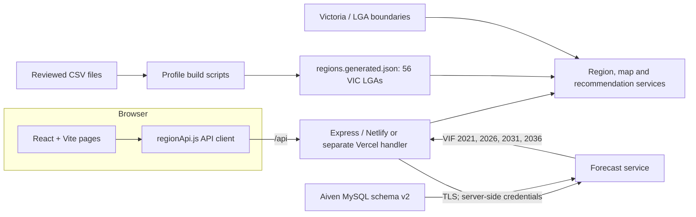

# Iteration 2 technical architecture — Ying's implementation draft

Owner: Ying Zhang (YZ). Status: current-branch architecture for team review, 15 September 2026. This describes the code on `fix/iteration2-api-error-state`, not a confirmed production deployment.

## Current boundaries

- The React frontend calls `/api` endpoints through `frontend/src/services/regionApi.js`. In local development this defaults to `http://localhost:3001/api`; a production build defaults to relative `/api` unless configured otherwise. Database credentials must stay in backend secrets, never in the browser.
- Region profiles and ranking still read `backend/src/data/regions.generated.json`, built from reviewed CSV files; the map also uses committed GeoJSON boundaries.
- The Towards 2050 flow now queries Aiven MySQL through `GET /api/forecasts/regions`. The backend maps stable website region IDs to LGA codes and reads the published VIF projection facts for 2021, 2026, 2031 and 2036. Database credentials and the CA certificate stay server-side.
- The rule-based recommendation service returns ranked regions, match scores, per-priority/factor weights, provenance and a location-proximity adjustment. Missing data can yield a neutral factor score; the UI must identify that fallback. The scores are relative explanations, not probabilities.
- The Towards 2050 page consumes the cloud forecast endpoint. It displays the published VIF series rather than claiming a newly trained model. The integrated projection horizon is 2036; school counts are present-day observations and are not future capacity estimates.
- The Compare page retains selected region IDs in a link to the outlook page. Both views use the same region IDs; a missing or invalid ID falls back to an available region rather than silently mixing geographic areas.

## Runtime and deployment

- Local: Vite frontend on port 5173, Express backend on port 3001.
- Repository configuration includes Netlify (`netlify/functions/api.js`) and Vercel (`api/index.js`) paths. These are alternatives, not proof that either is live. The response contract must remain aligned across both handlers and be checked against the actual deployed host.
- The Express app limits JSON request size and applies HTTP security headers. API routes validate recommendation input and supported map metrics; frontend empty/error states still need end-to-end checks after deployment.

## Remaining integration boundary

The VIF projection path is connected and locally verified against Aiven schema version 2.0.0. Region profiles, maps and recommendation scoring still use the reviewed file-built provider. Moving those remaining endpoints to MySQL requires a signed-off mapping for every displayed field, geography, period and null state. Production deployment also requires the `DB_*` secrets and Aiven CA value to be configured on the selected host. See `docs/Iteration2_API_Data_Contract_DRAFT.md` for endpoint-level details.
